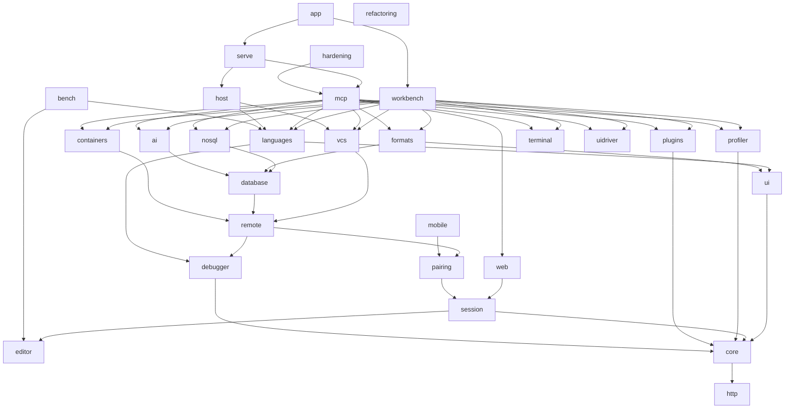

# Architecture

Ferris IDEA is a modular IDE written in Rust: 29 workspace crates. The mobile
apps have thin Swift and Kotlin shells over a Rust core, and the build and
check scripts are shell and Python. Language intelligence comes from external,
standardised servers (LSP, DAP) wherever possible; the IDE itself owns the
editor, the workspace model, the database tooling, the user interface and the
tools it offers to AI agents over MCP.

Decisions are recorded as ADRs in [`docs/adr/`](docs/adr/). This file is the
overview; it does not track status (see [docs/public/ROADMAP.md](ROADMAP.md)
and [CHANGELOG.md](CHANGELOG.md)). Every statement here
describes `main`; the crate diagram below is generated from `cargo metadata`
and checked by `scripts/check-docs.sh`.

## Layering

```
  binary         ┌────────────────────────────────────────────────────────────┐
                 │ app (idecraft): CLI, composition root, window self-test,   │
                 │ MCP over HTTP for the running window                       │
                 └────────────────────────────────────────────────────────────┘
  adapters       ┌──────────────────────┐ ┌──────────────────┐ ┌──────────────┐
                 │ workbench: window,   │ │ mcp: MCP server  │ │ serve:       │
                 │ views (GPUI,         │ │ (stdio,          │ │ headless     │
                 │ ADR-0003)            │ │ Streamable HTTP) │ │ backend      │
                 └──────────────────────┘ └──────────────────┘ └──────────────┘
  domain         languages (LSP, tree-sitter) · database (SQL) · nosql (MongoDB,
                 Redis) · vcs (Git) · debugger (DAP) · terminal (PTY) ·
                 containers (Docker, Kubernetes) · profiler · http (client) ·
                 plugins (WebAssembly) · ai (optional) · editor (buffer) ·
                 ui (themes, keymaps, no toolkit) · uidriver (semantic tree) ·
                 formats (exchange files)
  remote         remote (SSH) · session (protocol between window and serve) ·
                 host (a remote project's functions on the host) ·
                 pairing (encrypted paired channel) · web (WebSocket endpoint) ·
                 mobile (core of the mobile apps)
  base           ┌────────────────────────────────────────────────────────────┐
                 │ core: workspace, layered settings, file watching, search,  │
                 │ run configurations, project models, agent permissions,     │
                 │ local history                                              │
                 └────────────────────────────────────────────────────────────┘
  not shipped    bench (performance budgets) · hardening (fuzz, soak) ·
                 refactoring (empty placeholder)
```

The rows group the 29 crates by role; the exact edges are in the generated
graph below.

Rules:

1. There are no dependency cycles. The rows of the overview group crates by
   role, not by strict layer: `remote` uses `debugger`, and `host` uses
   `languages` and `vcs`. `core` depends only on `http` (for package index
   lookups). Four domain crates (`editor`, `http`, `terminal`, `uidriver`)
   depend on nothing in the workspace; `database`, `vcs` and `containers` use
   `remote`; `languages`, `ai`, `plugins` and `profiler` build
   on `core`, and `ui`, `database` and `debugger` use its file envelope
   (`core::format`, SPEC-0303). `formats` sits above `core`, `ui` and
   `database` and imports and exports the files that travel. Only `workbench` and `app` know the UI toolkit (`gpui`). `ui`
   holds themes, icons, keymaps and the tool window layout and stays
   toolkit-free unless its feature `view` is on (`workbench` switches it on),
   so the headless binary and MCP can use them.
2. `workbench` and `mcp` are the two adapters over the domain crates and do not
   depend on each other; `app` wires them together. `serve` is the headless
   backend for remote projects; it sits on `host` and `mcp` and knows no UI
   toolkit. `bench` and `hardening`
   are test harnesses on top and nothing depends on them. Domain crates are
   UI-agnostic and tested headless (`cargo test --workspace` needs no
   display).
3. External programs (language servers, debug adapters, Git, SSH, kubectl,
   profilers) are reached through protocols or their command line, never
   linked in-process when a standard protocol exists. Database drivers are the
   exception: they are native Rust libraries running inside the IDE process
   (ADR-0011), so there are no driver helper processes.
4. The rule is that every feature gets an MCP tool (`crates/mcp`, ADR-0008). This is a rule for
   new work; no check proves that every window feature has one.
   New domain behaviour goes into a domain crate; MCP tools and views only
   adapt it (ADR-0012 rules for new code).
5. No licence checks, trial periods, feature tiers or telemetry (ADR-0007).
6. Look and feel follows the open New UI assets (ADR-0009); code ported from
   `intellij-community` follows ADR-0006 and `docs/legal/APACHE_PORTING.md`.

## Crate dependencies

Generated by `scripts/crate-graph.sh` (direct workspace dependencies; an edge
that is already implied by a longer path is left out).

<!-- crate-graph:begin -->

<!-- crate-graph:end -->

## Crates

| Crate | Package | Responsibility | Key technology |
|---|---|---|---|
| `crates/core` | `idecraft-core` | workspace model (`SPEC-0001`), layered settings (`SPEC-0002`), file watching (`SPEC-0026`), find in files, Search Everywhere matcher, run configurations and commands, project models (Maven, Gradle, npm, Python, Ruby, IntelliJ project files), dependency trees, test reports, agent permissions and agent log (`SPEC-0053`), local history (`SPEC-0044`), IDE settings and recent projects | `toml`, `serde`, `quick-xml`, `regex`; file watching by polling |
| `crates/editor` | `idecraft-editor` | text buffer with undo/redo (`SPEC-0003`), selections and multiple carets (`SPEC-0025`), editor actions by keymap id (`SPEC-0056`, `SPEC-0057`), registry of open documents shared by the window and MCP (`SPEC-0220`) | `ropey` |
| `crates/languages` | `idecraft-languages` | language identification (`SPEC-0004`), syntax highlighting, folding and structure (tree-sitter), LSP client and server registry, long-lived language server pool shared by window and MCP (`SPEC-0090`), code insight, rename, formatting, code actions, inspections, Search Everywhere sources | `tree-sitter` with 28 grammar crates, own JSON-RPC over stdio, `tokio` |
| `crates/database` | `idecraft-database` | dialects and script splitting (`SPEC-0005`), connection profiles, sessions, introspection, completion, result sets and export, data editing, DDL, schema comparison, ER model and layout, SQL rename, permissions for agents, secrets in the OS keychain | `tokio-postgres`, `mysql_async` (MySQL, MariaDB), `rusqlite`, `duckdb` (bundled engine, no download), `oracle`, `tiberius` (SQL Server) behind one session interface (ADR-0011); connector catalogue of declarative definitions (ADR-0020); `keyring`; `resvg` for diagram images |
| `crates/nosql` | `idecraft-nosql` | non-relational stores (ADR-0022): store profiles in `.idecraft/stores.toml`, MongoDB and Redis sessions, console languages (MongoDB shell subset without JavaScript, `redis-cli` quoting), browser tree, tree/grid/JSON views, edits with preview, export (`SPEC-0310`–`SPEC-0312`) | official `mongodb` driver (rustls TLS), `redis` 1.x; keychain and agent rights from `idecraft-database` |
| `crates/debugger` | `idecraft-debugger` | DAP client, adapter detection, launch and attach, breakpoints (conditions evaluated by Ferris IDEA when the adapter cannot), stack and variables model | own `serde` types for DAP |
| `crates/vcs` | `idecraft-vcs` | Git status, diff, history, blame, branches, commit with hooks, merge, three-way text merge, rebase, stash, cherry-pick, remotes | `gix`, `similar`; the `git` program for fetch/pull/push, commit hooks and conflict resolution |
| `crates/terminal` | `idecraft-terminal` | programs in a pseudo terminal, screen model, saved sessions, scrollback search, shell integration (`SPEC-0038`, `SPEC-0205`–`SPEC-0207`) | `portable-pty`, `vte` |
| `crates/http` | `idecraft-http` | HTTP client: request files, environments, sending (`SPEC-0046`, `SPEC-0102`) | own HTTP/1.1, `native-tls` |
| `crates/containers` | `idecraft-containers` | Docker and Kubernetes (`SPEC-0119`, `SPEC-0240`–`SPEC-0243`): containers, shells, ports and port forwards, Compose, engines | Docker Engine API over its Unix socket or TCP (no Docker CLI); `kubectl` |
| `crates/remote` | `idecraft-remote` | remote hosts over SSH (`SPEC-0121`, `SPEC-0253`): browse, edit, run, file operations; remote projects with `idecraft serve` on the host (`SPEC-0317`: upload with SHA-256 check, start, attach, reconnect) | the system `ssh` |
| `crates/session` | `idecraft-session` | session protocol between the window and `idecraft serve` (ADR-0026, `SPEC-0317`): frames, JSON-RPC with stable error codes, version choice, backend-owned documents with operational transformation, numbered events with replay, reattach socket with peer check, audit log, the window's optimistic half with recovery copies | own frames and JSON-RPC over any byte stream (SSH stdio, in-process pipe, Unix socket) |
| `crates/host` | `idecraft-host` | the functions of a remote project that run on the host (`SPEC-0318`): language servers, inspections, search, Git, terminals, runs, port forwarding and the debug-adapter start, bound into `idecraft serve`; paths that leave the project folder are refused | no TCP listener of its own; servers and adapters over standard input and output |
| `crates/serve` | `idecraft-serve` | the headless backend `idecraft serve` (`SPEC-0317`, `SPEC-0321`, ADR-0026): `--stdio` for the SSH channel, `--attach`, `--pair` for hosts without SSH, `--wss` for browsers, device list and revoke | no windowing toolkit |
| `crates/pairing` | `idecraft-pairing` | the paired channel (`SPEC-0321`, ADR-0025 §1b, §1c): hybrid Noise handshake with ML-KEM-1024, encrypted channel, key store, pairing with a short code, the listener of `idecraft serve --pair` | `snow`, `libcrux-ml-kem` |
| `crates/web` | `idecraft-web` | the WebSocket endpoint of `idecraft serve --wss` (`SPEC-0325`): TLS 1.3 with the hybrid group X25519MLKEM768 only, origin and host checks, authentication before the backend; no browser client exists yet | `rustls` |
| `crates/mobile` | `idecraft-mobile` | shared core of the mobile apps (ADR-0029, `SPEC-0326`): pair with a machine running `idecraft serve --pair`, list and read the files of its project; keys go through the platform keychain | `uniffi` bindings for Swift and Kotlin; allows `unsafe` for the generated bindings. The only other crate with `unsafe` is the binary crate `crates/app`, which does not apply the workspace lints (process start-up and macOS AppKit calls, four files) |
| `crates/uidriver` | `idecraft-uidriver` | UI driver (ADR-0027, `SPEC-0319`): semantic tree in AccessKit's schema, locators by role, name and test id, waits on presented frames, actions, assertions, traces and audit without content, the security rules of external driving (right `ui`, effects, reserved elements, emergency stop) | toolkit-free; the window feeds it trees and delivers its input |
| `crates/profiler` | `idecraft-profiler` | CPU and memory profiles as call trees (`SPEC-0120`, `SPEC-0250`–`SPEC-0252`) | `/usr/bin/sample` (macOS), `perf` (Linux), `cProfile`, JDK Flight Recorder |
| `crates/plugins` | `idecraft-plugins` | plugins as sandboxed WebAssembly modules (`SPEC-0104`, ADR-0016) | `wasmi` with fuel and memory limits; host functions only as granted: read the project (`SPEC-0156`), connect to the picked profile's host and port (`SPEC-0314`, ADR-0024) |
| `crates/ai` | `idecraft-ai` | optional AI Assistant (`SPEC-0138`), off by default: an OpenAI-compatible endpoint the user names, or the provider's own command line program for a subscription (ADR-0017) | `idecraft-http`; API keys in the OS keychain |
| `crates/ui` | `idecraft-ui` | themes and colour schemes (`SPEC-0060`), bundled icons, keymaps (`SPEC-0028`), tool window layout (`SPEC-0167`) — no UI toolkit | `quick-xml`, `serde_json` |
| `crates/formats` | `idecraft-formats` | Ferris IDEA exchange files (`SPEC-0303`): import preview, import, export without secrets, Share link; the envelope, shapes and migrations are `core::format` | `toml`; JSON Schemas in `docs/formats/` |
| `crates/refactoring` | `idecraft-refactoring` | empty placeholder: LSP refactorings and undo groups live in `languages` and `editor`, SQL rename in `database` | — |
| `crates/workbench` | `idecraft-workbench` | window, editor view, project tree, tabs, tool windows, dialogs and popups | `gpui` (ADR-0003) |
| `crates/mcp` | `idecraft-mcp` | MCP server: agents use the IDE as a tool (`SPEC-0006`, 316 tools on 2026-11-16, ADR-0008) | `rmcp`; stdio, and Streamable HTTP on loopback over `hyper` (`SPEC-0221`) |
| `crates/app` | `idecraft` | binary: CLI, composition root, window self-test, MCP HTTP server of the running window | `gpui`, `tokio` |
| `crates/bench` | `idecraft-bench` | performance budgets and the headless benchmark harness (`SPEC-0260`); not part of the product | `toml`; measures `editor` and `languages` directly |
| `crates/hardening` | `idecraft-hardening` | fuzz targets for parsers and protocol decoders and the long-session MCP soak test (M8.2); not part of the product | depends on the domain crates and `mcp` it exercises; `cargo-fuzz` project beside it |

## Processes

| Process | Started by | Lifetime and transport |
|---|---|---|
| `idecraft ui [folder]` | the user | the desktop window; one process for all project windows |
| `idecraft mcp <folder>` | an MCP client (agent) | one process per client connection, MCP over stdin/stdout, one workspace |
| MCP HTTP server | the window, when the setting `mcp.http` is on (off by default; the user switches it on in Settings › AI Assistant) | threads inside the window process: Streamable HTTP on `127.0.0.1` at a port the system picks, a bearer token per start, `Host`/`Origin` checks, a discovery file (mode 0600) in the user's settings folder; serves every open project and sees unsaved editor text (`SPEC-0220`, `SPEC-0221`) |
| `idecraft open <folder>` | the user or scripts | headless summary of a workspace, then exits |
| `idecraft serve [<folder>] --stdio` | the window, over the system `ssh` on a remote host | the headless backend of a remote project: session protocol on standard input and output, owns the documents, keeps a session for a reattach after a broken connection (`SPEC-0317`, ADR-0026). It is not an MCP server |
| `idecraft serve` with `--pair`, `--wss`, `--attach`, `--devices` or `--revoke` | the user | the encrypted listener for hosts without SSH and paired devices, the WebSocket endpoint, the bridge to a waiting session, the device list. Both listeners bind `127.0.0.1` unless the network is allowed explicitly (`SPEC-0321`, `SPEC-0325`; In progress) |
| `idecraft drive <verb> …` | the user or scripts | the UI driver from a shell: talks to a running window; external driving is off by default (`SPEC-0319`; In progress) |
| `idecraft trust` with `status`, `add`, `list` or `remove` | the user | reads and changes the store of trusted project folders, then exits (`SPEC-0278`) |
| `idecraft quit` with `--save-all`, `--discard` or `--force` | the user or scripts | asks the running window to quit, then exits |
| `idecraft call <folder> <tool> [<json>]` | the user or scripts | one MCP tool call over an in-memory pipe, prints the result as JSON, then exits (`SPEC-0281`) |
| `idecraft launch [folder]` | `IDECraft.app` (Finder, Dock), the Linux desktop entry | the desktop window on the folder, the most recent project, or a folder chosen in the system's dialog (`SPEC-0282`) |
| `idecraft container-exec …` | the Containers window | the program of a terminal tab that bridges a container shell over the Engine API |
| language servers | the language server pool | one per workspace root and server command, JSON-RPC over stdio, shared by the window and MCP in the same process (`SPEC-0090`) |
| debug adapters | a debug session | DAP over stdio or TCP; ends with the session |
| shells and run configurations | terminal tabs, Run window, agents with the `run` right | children in a pseudo terminal or with pipes |
| `git`, `ssh`, `kubectl`, profilers | the operations that need them | short-lived children; port forwards (`kubectl port-forward`) last until stopped or the IDE exits |
| plugins | a plugin action | no process: a fresh `wasmi` instance inside the calling process per call |
| database sessions | a connection | no process: native drivers inside the IDE process |
| mobile apps (`mobile/ios`, `mobile/android`) | the user, in a simulator or emulator | native shells over `crates/mobile`; they reach a machine through the paired channel (In progress) |

## Data flow for an edit

1. The window turns a key press into an action id through the keymap
   (`ui` keymaps, user overrides in the settings).
2. `editor::perform` applies the action to the buffer and records it for
   undo; the same function serves the keymap, menus and the MCP tool
   `editor_action`.
3. The editor view publishes the new text to the open-document registry
   (`editor::DocumentRegistry`), so MCP tools read the unsaved text.
4. The workbench sends changed revisions to the language server pool
   (`textDocument/didChange` with the unsaved text); diagnostics come back and
   are shown in the editor and the Problems window.
5. The syntax tree is re-parsed incrementally (tree-sitter `InputEdit`) for
   highlighting and folding.
6. Saving writes the file, records the previous content in local history and
   refuses to overwrite a file that changed on disk until the user saves
   again.

## Agent access

MCP tools run the same domain code as the window. Reading files of the
workspace, previews and dry runs are free. Every tool that changes something
checks a right the user grants per workspace in their own settings folder
(14 rights, `crates/core/src/permissions.rs`, `SPEC-0053`). Database access
for agents has four permissions per connection; the user grants them per
workspace, connection and target in the same grant file, nothing is granted by
default, and the project's connection file can only narrow them (`SPEC-0012`,
[ADR-0031](docs/adr/0031-project-files-never-grant-agents.md)). In an
untrusted project Ferris IDEA is built to run none of the project's code and to
refuse every tool that names a connection of the project (`SPEC-0278`).

One table, `TOOLS` in `crates/mcp/src/effects.rs`, has a row per tool: what it
changes, how a dry run is asked for, and the rights its code checks. The
central dispatch writes the agent-log line of every changing call from that
row, and tests fail for a tool without a row, for a changing effect without a
right and for a right named in the row that the tool's code does not check.
The tests read the handlers' source: they prove that a check is written, not
that every path reaches it.

The user's view of this model, with the full list of its limits (no sandbox;
formatters, linters and language servers start under trust alone; the log is
a local file), has one home: the README section
[What the Model Does Not Cover](README.md#what-the-model-does-not-cover).
Ferris IDEA contains no agent loop and no model (ADR-0023).

## Direction

Ferris IDEA is presented as an IDE AI harness: the IDE's own operations are tools
for agents, under rights, previews and a local log of runs and requests
([ADR-0023](docs/adr/0023-idecraft-as-agent-harness.md), status *proposed*).
Planned, none of it built: verification gates, change sets, context packs, a
harness benchmark and a sandbox for started programs.

Quality gate QG-1 ([ADR-0015](docs/adr/0015-quality-gate-ai-native.md)) is recorded as reached on
2026-11-16 ([gate report](docs/quality/QG-1-REPORT.md)). After the database tools, Ferris IDEA is
planned to grow so that people
and agents use the same core: a headless core and one versioned capability layer
([ADR-0012](docs/adr/0012-headless-core-capability-api.md)) with MCP, ACP, CLI and SDK as adapters
([ADR-0013](docs/adr/0013-protocol-adapters.md)), and orchestration of several agents under grants
and budgets ([ADR-0014](docs/adr/0014-orchestration-principles.md)). Vision:
[docs/architecture/AI_NATIVE_VISION.md](docs/architecture/AI_NATIVE_VISION.md); current gaps:
[docs/architecture/READINESS.md](docs/architecture/READINESS.md). Rules from ADR-0012 that apply to new
code already: domain logic lives in domain crates (not in MCP tools or views), new long-running
operations take a cancellation handle and return stable error codes, no global workspace state.

Remote work is the second direction, and part of it is on `main` already
([docs/architecture/REMOTE_AND_MOBILE.md](docs/architecture/REMOTE_AND_MOBILE.md), network rules in
[ADR-0025](docs/adr/0025-network-security-for-remote-connections.md)): remote projects on
`idecraft serve` (Experimental); remote debugging, more host types, paired devices and project
rooms for working together (In progress, the rooms as a server half only); mobile apps (In
progress, simulator and emulator only); a web IDE in the browser (Planned; the WebSocket endpoint
exists, a client does not, [ADR-0028](docs/adr/0028-web-client-rendering.md)).

## Technology evaluation

See [ADR-0003](docs/adr/0003-ui-toolkit.md) for the UI decision and
[`docs/research/TECH_EVALUATION.md`](docs/research/TECH_EVALUATION.md) for the
other components. Rust packages are limited by their declared licence to an
allow-list of permissive licences plus MPL-2.0 and three narrow exceptions;
`cargo deny` enforces it ([`deny.toml`](deny.toml)). Native libraries compiled
in are listed in [THIRD-PARTY-NOTICES.md](THIRD-PARTY-NOTICES.md); one of
them, libgit2, is GPL-2.0 with a linking exception.

## Traceability

Every module names the specification it implements (`SPEC-xxxx`); every test
names the acceptance criterion it covers (`SPEC-xxxx/AK-n`). The matrix lives
in [`docs/specifications/TRACEABILITY.md`](docs/specifications/TRACEABILITY.md).
Process: [`docs/legal/RESEARCH_BOUNDARIES.md`](docs/legal/RESEARCH_BOUNDARIES.md).
