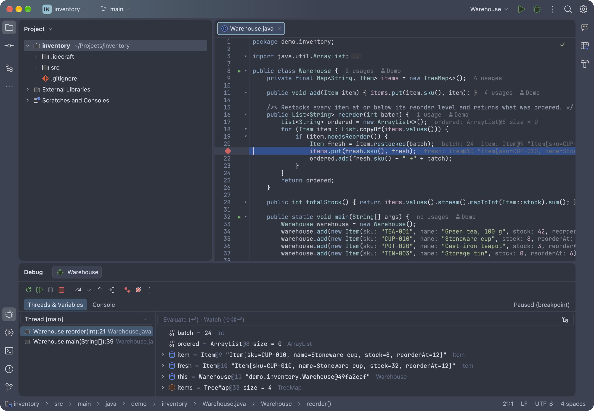
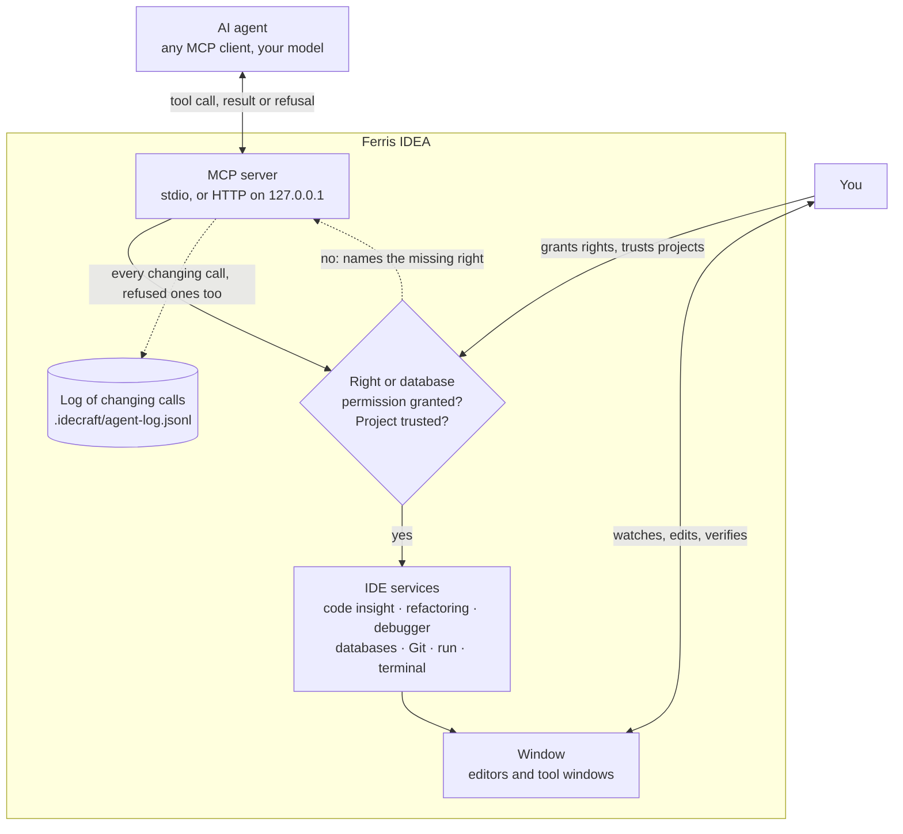
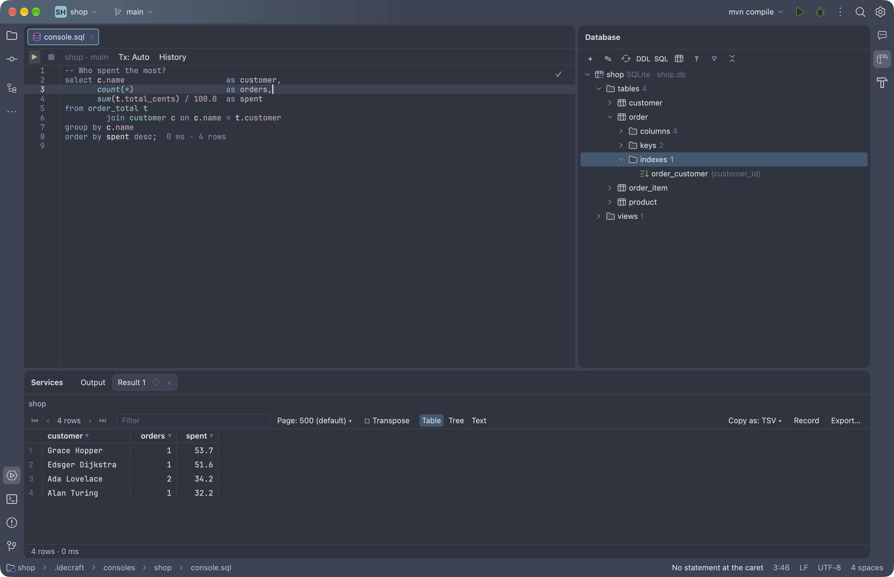
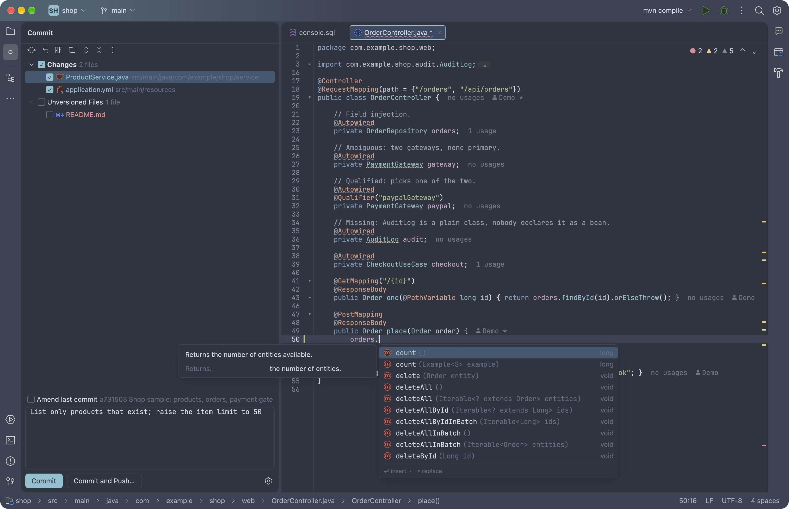
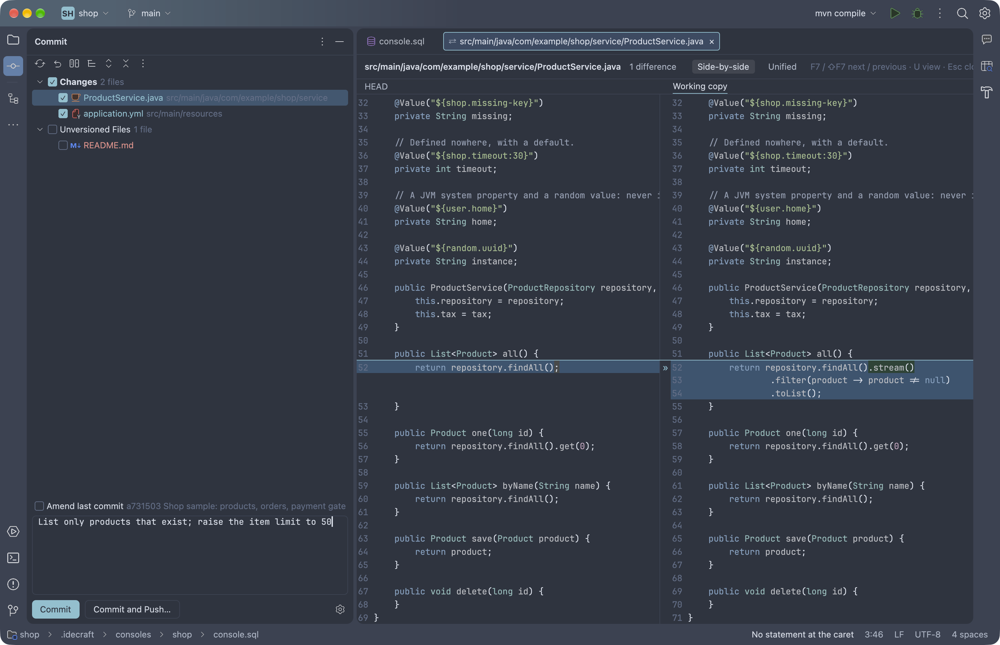

<p align="center">
  <picture>
    <source media="(prefers-color-scheme: dark)" srcset="docs/design/assets/idecraft-symbol.svg">
    
  </picture>
</p>

<h1 align="center">Ferris IDEA</h1>

<p align="center">
  <b>Your IDE. Your database. Your model.</b><br>
  A Rust-native IDE with a built-in SQL client, where you and the AI you choose build software together.
</p>

<p align="center">
  <a href="#development-status"></a>
  <a href="#license"></a>
  <a href="#platforms-and-requirements"></a>
</p>

<p align="center">
  <a href="#what-an-agent-can-do-with-it">AI harness</a> ·
  <a href="#try-it-in-five-minutes">Try it</a> ·
  <a href="#features">Features</a> ·
  <a href="#development-status">Status</a> ·
  <a href="#the-story">Story</a> ·
  <a href="#build-from-source">Build</a> ·
  <a href="docs/README.md">Docs</a>
</p>

<p align="center">
  
</p>

<p align="center"><sub>A Java program paused at a breakpoint, with inline values and the Debug tool window · demo project · theme IDECraft Dark · debug build of commit <code>970f18e3</code>, 2026-11-14</sub></p>

<!-- SCREENSHOT (missing, hero light): the same window, project and state in theme IDECraft Light, 1440×900 at 2×, as docs/images/shot-1-hero-light.png; then wrap both in one <picture> with a prefers-color-scheme source. Until it exists the dark image is shown in both modes. -->

Ferris IDEA is a desktop IDE written in Rust: editor, code insight through language servers,
debugger, Git, database tools, HTTP client and terminal in one window. It is also what we call an
**IDE AI harness**: 327 of its operations are typed MCP tools, so an agent you bring can rename a
symbol, stop at a breakpoint or run SQL through the IDE instead of through a shell, and every tool
that changes something checks one of 15 rights you grant per workspace, or a database permission
you grant per connection. The first commit
is from 2026-10-30; the code was written almost entirely by AI agents, and no person has read all
of it. One human project owner decides scope and approvals, and its functional target is the scope of IntelliJ IDEA Ultimate, including
database tooling.

<sub>Independent project: not affiliated with, endorsed by, or sponsored by JetBrains. Full notice: <a href="#independent-project-notice">Independent Project Notice</a>.</sub>

> [!WARNING]
> **Version 1.0 (v1.0.0), for two workflows.** A signed and notarized download for macOS on Apple
> Silicon is on the [v1.0.0 release](https://github.com/DamienDrash/ferris-idea/releases/tag/v1.0.0);
> elsewhere you build it from source. The window is verified on macOS on Apple Silicon only. Of 57 feature rows, 37 are checked side by side against the reference; many newer
> features have only automated tests. No external security review. Every known gap:
> [Development Status](#development-status).

## Highlights

Each line carries a status word; the words are defined under [Features](#features).

- Rename, extract variable, constant and method, and inline, across files: **Works**
- Completion, diagnostics, quick fixes and navigation for Python, JavaScript and TypeScript, Java
  and Kotlin, through language servers you install: **Works**
- Debugger over DAP with six adapters; test runner with a result tree: **Works**
- Git from status to rebase, with hooks: **Works**
- SQL console, result grid and data editing: **Works**; 13 database connectors tested live:
  **Experimental**
- All of the above as MCP tools for an agent, under rights: **Experimental**
- Remote projects over SSH with a backend on the host: **Experimental**
- No account and no license check in the product; no telemetry or update check was found by static
  reading of the code

## Use It, or Not Yet

**Try Ferris IDEA if**

- you build agents and want to see what they do with a debugger, a database session and
  refactorings instead of a shell;
- you want to read a specification-first codebase written by agents;
- you work on macOS on Apple Silicon and are willing to build from source.

**Do not use it yet if**

- you need an IDE for daily work;
- you are on Windows, or on Linux and need the window;
- you need a screen reader;
- you need an audited security boundary between an agent and your machine;
- you need an OSI-approved license.

## What an Agent Can Do with It

**IDE AI harness** is our term for an IDE that offers its own operations to AI agents as typed
tools: refactorings, the debugger, database sessions, version control, run configurations, the
window itself.

In Ferris IDEA every tool that changes something checks a right you grant, a part of the tools
previews first by default, and every call that changes something leaves a line in a local log. The agent's
loop and its model stay outside: Ferris IDEA ships no agent and no model. It supplies the tools, the
checks and their limits, and the window in which you watch and verify.

<!-- SCREENSHOT (missing, permission alert): the window while an MCP client over HTTP calls a tool without the needed right: the native alert naming the client, the right, the action and the workspace, with the buttons Deny, Allow Once, Always for This Workspace. Demo project, theme IDECraft Dark, 1440×900 at 2×, as docs/images/shot-5-permission-alert.png. Visible, directly here. -->



<sub>How a tool call travels. Reading files and previews need no right. A tool with a dry run previews unless the call says otherwise. Dotted lines: not every call takes them. What the gate does not cover is listed under <a href="#what-the-model-does-not-cover">What the Model Does Not Cover</a>.</sub>

### Try It in Five Minutes

```sh
cargo build -p idecraft
claude mcp add idecraft -- "$PWD/target/debug/idecraft" mcp /path/to/project
```

For any other MCP client, the same server as a configuration entry:

```json
{
  "mcpServers": {
    "idecraft": {
      "command": "/absolute/path/to/idecraft",
      "args": ["mcp", "/absolute/path/to/project"]
    }
  }
}
```

> [!NOTE]
> The project is developed and hand-tested with Claude Code. The `claude mcp add` line is that
> client's syntax. Other clients are expected to work with the entry above and are not tested yet.

| Way in | Command or address | Status |
|---|---|---|
| MCP over stdio, no window | `idecraft mcp <directory> [--trust]` | Works |
| One tool call from a shell | `idecraft call <directory> <tool> ['<json>']` | Works |
| MCP over HTTP from the running window, with your unsaved editor text | `http://127.0.0.1:<port>/mcp`, bearer token per start | Experimental |
| Drive the window from a shell | `idecraft drive <verb> …` | In progress |

MCP over HTTP is off by default. Switch it on in Settings › AI Assistant › "Serve MCP to local
agents over HTTP"; it starts at once, without a restart. The running window then writes the HTTP
address and token to `mcp-http/<pid>.json` in your settings folder. Do not paste that token into an issue or a chat. The server offers tools only: no MCP
resources, prompts, sampling or elicitation.

What an agent does with it, in five steps. Every tool can be tried from a shell with
`idecraft call`.

1. **A semantic preview.** `rename_symbol` answers with the edits it would make across files; a
   dry run is its default.

<!-- CAPTURE A (console): `idecraft call tests/reference-projects/python-basic rename_symbol '<arguments per the tool's inputSchema>'` with the default dry run, on a symbol used in at least two files. Needs pyright on the PATH; name its version in the caption. Paste the real output in a console block here; mark every cut with … and say so in the caption. -->

2. **The gate.** The same call with `"dry_run":false` and no `write` right is refused, and the
   refusal names the entry to add.

<!-- CAPTURE B (console): the same rename_symbol call with "dry_run":false and an empty grant file (isolated IDECRAFT_CONFIG_DIR). Paste the real refusal, including the TOML entry it names. Then the same call after the grant, showing the applied result. -->

3. **The debugger.** `set_breakpoint`, `debug_start` and `debug_evaluate` stop a program at a line
   and return a variable's value.

<!-- CAPTURE C (console): on the same sample project, three calls: set_breakpoint (dry_run false, needs `write`), debug_start (needs `debug` and a trusted project), debug_evaluate at the stop returning one variable's value; then debug_stop. Needs debugpy. Paste real output, cuts marked. -->

4. **A database.** A connection the project describes gives an agent nothing until you grant it.
   In a project you have not trusted (`idecraft trust add ~/shop`) the connection is not even
   opened. In a trusted one, the refusal names the entry to add:

```console
$ idecraft call ~/shop run_sql '{"connection":"shop","sql":"select name, city from customer order by name"}'
error: not granted: nothing was run: connection `shop` does not grant everything the SQL needs: statement 1 (read data) needs permission `read-data`; nobody was asked. What a project file says about agents grants nothing: only the user can grant it, by answering "Always for This Connection" when the Ferris IDEA window asks a client of its MCP server over HTTP, or by adding to ~/.config/idecraft/agent-permissions.toml:

[[connection]]
workspace = "~/shop"
connection = "shop"
target = "sqlite:shop.db#9fef824b5cac0e97"
allow = ["read-data"]

The grant holds while the connection keeps this target.
```

   After you added that entry, the query returns typed rows. A statement that changes data is
   previewed, and with `apply: true` it is refused, because you granted reading only and the
   project's connection file allows no more:

```console
$ idecraft call ~/shop run_sql '{"connection":"shop","sql":"select name, city from customer order by name"}'
{
  "results": [
    {
      "statement": 1,
      "start": 0,
      "end": 45,
      "columns": [
        "name",
        "city"
      ],
      "rows": [
        [
          "Ada Lovelace",
          "London"
        ],
        [
          "Alan Turing",
          "Manchester"
        ],
        [
          "Grace Hopper",
          "New York"
        ]
      ],
      "row_count": 3,
      "truncated": false
    }
  ],
  "not_run": 0
}
$ idecraft call ~/shop run_sql '{"connection":"shop","sql":"insert into customer (name, city) values ('\''Edsger Dijkstra'\'', '\''Rotterdam'\'')"}'
{
  "applied": false,
  "connection": "shop",
  "statements": [
    {
      "statement": 1,
      "start": 0,
      "end": 73,
      "chars": 73,
      "permission": "modify-data",
      "changes": true
    }
  ],
  "note": "nothing was run: a script with a statement that can change data or schema runs only with apply: true"
}
$ idecraft call ~/shop run_sql '{"connection":"shop","sql":"insert into customer (name, city) values ('\''Edsger Dijkstra'\'', '\''Rotterdam'\'')","apply":true}'
error: not granted: nothing was run: the project file .idecraft/connections.toml allows agents at most `read-schema`, `read-data` on connection `shop` (its `ai` line; without one, reading only), so `modify-data` cannot be given; nobody was asked. Only the user can change that line, and the permission then still has to be granted by the user. The connection does not grant everything the SQL needs: statement 1 (modify data) needs permission `modify-data`.
```

5. **The record.** Each of those calls left one line in the workspace's log, the refused ones
   too. The line holds lengths and classes, never the statement:

```console
$ tail -n 2 ~/shop/.idecraft/agent-log.jsonl
{"time":1794642664,"tool":"run_sql","call":true,"changes":["database"],"dry_run":true,"rights":[],"database":[{"connection":"shop","permissions":["modify-data"],"dry_run":true,"ok":true,"chars":73,"kinds":["modify-data"]}],"targets":{"connection":"shop"},"lengths":{"sql":73},"result":"ok"}
{"time":1794642664,"tool":"run_sql","call":true,"changes":["database"],"dry_run":false,"rights":[],"database":[{"connection":"shop","permissions":["modify-data"],"dry_run":false,"ok":false,"refused":"project-file","chars":73,"kinds":["modify-data"]}],"targets":{"connection":"shop","apply":true},"lengths":{"sql":73},"result":"refused"}
```

<details>
<summary><b>More examples: files, programs, withheld secrets (real output)</b></summary>

Reading, without a window:

```console
$ idecraft call ~/demo workspace_info
{
  "name": "demo",
  "root": "~/demo",
  "files": 2,
  "languages": {
    "other": 1,
    "python": 1
  }
}
$ idecraft call ~/demo read_file '{"path":"app.py","start_line":1,"end_line":1}'
"def greet(name):"
```

A change previews first. Applying it needs a right:

```console
$ idecraft call ~/demo copy_file '{"path":"app.py","target_dir":".","new_name":"app_copy.py"}'
{
  "applied": false,
  "mode": "copy",
  "from": "app.py",
  "to": "app_copy.py",
  "folder": false,
  "files": 1,
  "folders": 0,
  "free_name": "app_copy.py",
  "summary": "Copied app.py to app_copy.py"
}
$ idecraft call ~/demo copy_file '{"path":"app.py","target_dir":".","new_name":"app_copy.py","dry_run":false}'
error: not granted: this workspace does not grant agents the `write` right (create, change, move or delete files of the workspace); nobody was asked. Only the user can grant it: answer "Always for This Workspace" when the Ferris IDEA window asks a client of its MCP server over HTTP, or add to ~/.config/idecraft/agent-permissions.toml:

[[workspace]]
path = "~/demo"
allow = ["write"]

Use dry_run to see what would happen.
```

A program runs only when the call says `dry_run:false`, the workspace grants `run` and the project
is trusted. With the right but without trust:

```console
$ idecraft call ~/demo run_command '{"command":["python3","-c","print(6*7)"]}'
{
  "dry_run": true,
  "would_run": {
    "command": [
      "python3",
      "-c",
      "print(6*7)"
    ],
    "cwd": ".",
    "timeout": 120
  }
}
$ idecraft call ~/demo run_command '{"command":["python3","-c","print(6*7)"],"dry_run":false}'
error: Safe mode: ~/demo is not trusted, so Ferris IDEA runs none of its code (build scripts, build-tool sync, run configurations, tests, tasks). Trust it with "Trust Project…" in the banner, `idecraft trust add <folder>`, or the MCP tool trust_project.
```

After `idecraft trust add ~/demo`:

```console
$ idecraft call ~/demo run_command '{"command":["python3","-c","print(6*7)"],"dry_run":false}'
{
  "name": "run_command",
  "exit_code": 0,
  "timed_out": false,
  "stopped": false,
  "start_error": null,
  "stdout": "42\n",
  "stderr": "",
  "millis": 40,
  "report": null,
  "report_error": null,
  "success": true,
  "stdout_truncated": false,
  "stderr_truncated": false
}
```

A file whose name commonly holds secrets is withheld:

```console
$ idecraft call ~/demo read_file '{"path":".env"}'
error: withheld: `.env` is on the list of files whose names commonly hold secrets (environment file); its text is given only with the `secret-read` right. not granted: …
```

</details>

<sub>Console blocks on this page: real output of a debug build of commit <code>1e57cd9f</code>, run on 2026-11-14 with an isolated settings folder on two small folders (a SQLite file with one table; two files). Edited for the page in two ways only: the long paths of the test folders are written as <code>~/shop</code>, <code>~/demo</code> and <code>~/.config/idecraft</code> (in the output the paths are absolute), and the last block is cut at <code>…</code>. The summary line of the dry run of <code>copy_file</code> says "Copied" although nothing was copied; that is the tool's wording today.</sub>

### How It Differs

| Compared with | The difference |
|---|---|
| An IDE with a chat panel | There the assistant is a feature inside the IDE. Here the IDE is the agent's instrument: any external agent drives it through a protocol, and the chat panel is optional. |
| An agent that edits files through a shell | Such an agent sees text and exit codes. Here it gets the project's semantics ("rename this symbol", "who calls this", "stop at this line and read the variable") and rights per operation instead of per shell command. |
| A language-server bridge | A bridge exposes what one language server knows about code. Here the tools also cover the debugger, databases, version control, run and test, the HTTP client, containers and remote hosts. |
| An MCP toolkit built on language servers | Such a toolkit gives an agent symbol-level tools without a window. Ferris IDEA is the IDE itself: the operations a person uses in the window, with the person watching in that window. |

These are differences of design. Whether they make agents measurably better is not shown yet; a
benchmark is Planned.

### What an Agent Can Use

The agent path as a whole is **Experimental**: usable, tested by protocol tests, with hand tests
open. That holds for every row, whatever status the same feature has in the window under
[Features](#features). The window is driven by tools only in part: **In progress**, key presses
only.

<details>
<summary><b>Tools by area</b></summary>

Grouped by tool name; each tool is counted in one group, and the groups add up to all 327 tools. A
count says nothing about depth.

| Area | Tools |
|---|---|
| Workspace, files, search, local history | 33 |
| Code insight and inspections, through the language servers you installed | 35 |
| Refactoring, code actions, formatting | 23 |
| Git: status to rebase, with hooks and conflicts | 30 |
| Debugger: breakpoints, stepping, variables, evaluate | 27 |
| Databases: schemas, SQL, data, comparison, export | 41 |
| Run, build, terminal, HTTP client, profiler | 28 |
| Languages and environments, containers | 25 |
| Remote hosts over SSH, remote projects, pairing, shared rooms | 45 |
| Rights, trust, settings, plugins, the AI assistant | 20 |
| Window: tabs, tool windows, dialogs, notifications, keymap | 11 |
| Operate the window by role and name (`ui_*`) | 9 |

</details>

### What Keeps You in Control

- **Rights per workspace.** Reading files of the workspace and previews are free. Every tool that
  changes something (project files, the repository, your settings, the state of the window, a
  process, a database) checks one of 15 rights: `write`, `vcs-write`, `run`, `http`, `debug`,
  `remote`, `ssh`, `trust`, `quit`, `terminal-read`, `ports`, `ui`, `secret-read`, `settings`,
  `recent-projects` (reading the folders of your other recent projects). One
  table has a row per tool that names what it changes and which rights it checks, and tests fail
  for a tool without a row and for a change without a right
  ([SPEC-0053](docs/specifications/SPEC-0053-agent-permissions.md)).
- **A project file never grants an agent anything.** Rights and database permissions are kept in
  `agent-permissions.toml` in your settings folder. A file of the project can take away from an
  agent, never give, and no MCP tool writes the grant file
  ([ADR-0031](docs/adr/0031-project-files-never-grant-agents.md)).
- **Database permissions are yours.** Each connection has four (`read-schema`, `read-data`,
  `modify-data`, `modify-schema`). You grant them per workspace, connection and target; nothing is
  granted by default, reading included. The project's connection file can only narrow them. When
  the project changes where a connection leads, your grant no longer applies. A statement that can
  change data or schema runs only with `apply: true`. A file database lies inside the workspace,
  or you granted exactly that file
  ([SPEC-0012](docs/specifications/SPEC-0012-sql-over-mcp.md)).
- **Preview first, on a part of the tools.** 93 tools have a `dry_run` parameter and act only
  with `dry_run: false`; the database tools preview until the call says `apply: true` (counted
  from the tool schemas, 2026-11-16).
- **Project trust.** In an untrusted project Ferris IDEA is built to run none of the project's code,
  whatever the rights, and to refuse every tool that names a connection of the project
  ([SPEC-0278](docs/specifications/SPEC-0278-project-trust-and-safe-mode.md)).
- **Exact refusals.** A refused call names the right and the entry to add, and says that nobody
  was asked. Over HTTP the window asks you instead: Deny, Allow Once, or Always for This
  Workspace (for a database: Always for This Connection). Without a window the call is refused.
- **Secrets by file name.** `.env` files, keys, key stores and similar are withheld without
  `secret-read`. Database passwords and API keys stay in the OS keychain and are never returned.
- **A local log of every changing call.** Each call of a tool that changes something appends one
  line to `.idecraft/agent-log.jsonl`, refused calls and dry runs included, and so does each call
  that uses a database connection, also when it only reads. The line names the tool, what it
  changes, the rights checked and the result. It never holds file contents, statements, commands
  or values.

### What the Model Does Not Cover

> [!CAUTION]
> **Read this before you grant `run`, and before you connect an agent to a project you did not
> write.** With `run`, in a trusted project, an agent starts programs as you. There is no sandbox.

- **No sandbox.** There are no per-command allow lists. *Planned: tighter containment, after the
  quality gate.*
- **Some tools that only read start a program or reach a service of yours without a right.**
  Language servers start under project trust alone. So do the project's own formatter and linter
  (`format_file`, `prettier_file`, `eslint_file`, `optimize_imports`), also in a dry run. Commit
  hooks run under `vcs-write`. Listing processes and reading the Docker engine or a Kubernetes
  cluster need no right. These are recorded as open for a later decision (SPEC-0053, behavior 14).
- **The rule "every change checks a right" is held by tests that read the tools' source.** They
  prove that a check is written in a tool's code, not that every path reaches it. Two marked
  exceptions need no right: the emergency stop of the UI driver and `local_history`, which writes
  only Ferris IDEA's own record.
- **SQL is classified by its text.** A function or view of the database's own that changes data
  when a query reads it is not seen; the read-only session is the second line of defense there.
- **The log is a record, not evidence.** It is a plain local file that a program started with
  `run` could alter, and it does not hold what was written, only that a call changed something.
- **Dry run is not universal.** Tools without one act at once when the right is granted, for
  example `rename_file`, `git_create_branch` and `git_stash`. *Planned: a dry run
  for the remaining writing tools.*
- **Secrets are recognized by file name only.** A secret in a file with an ordinary name is not
  recognized. Output of programs and HTTP responses is not filtered.
- **The HTTP transport is off by default.** You switch it on in Settings › AI Assistant (setting
  `mcp.http`). Then it listens on loopback only, on a random port, with a new token per start and
  `Host` and `Origin` checks. The token is in a file only your user can read, which means every
  process running as you can read it. An agent can switch the transport off over MCP, never on.
- **Results are rarely marked as untrusted.** 2 of the tool descriptions tell the agent not to
  follow instructions in the result (`terminal_read`, `run_output`); 2 more mark plugin-supplied
  names as untrusted data. Prompt injection through file content remains possible. *Planned:
  marking on every tool that returns project, terminal, database or web content.*
- **The UI driver is early.** External clients can press keys; pointer actions, typing into
  editors and screenshots answer `unsupported`. Two tool windows carry semantic annotations.
  *In progress.*
- **No external security review** has been done.

Report a security problem privately: [SECURITY.md](SECURITY.md). Specifications:
[agent rights](docs/specifications/SPEC-0053-agent-permissions.md) ·
[MCP over HTTP](docs/specifications/SPEC-0221-mcp-http-transport.md) ·
[UI driver](docs/specifications/SPEC-0319-ui-driver.md) ·
[SQL over MCP](docs/specifications/SPEC-0012-sql-over-mcp.md)

### What Leaves Your Machine

Nothing by Ferris IDEA's own choice: it has no account and no license check, and no telemetry or
update check was found by static reading of the code (not verified by watching the running
window's traffic). Tools it starts for you in a trusted project, such as language servers, build
tools and package managers, may use the network themselves. Your agent is a separate program: what
it reads through the tools, including rows of a connected database, goes to its model provider
under that provider's terms.

## Features

Status words, in order of maturity: **Works** (implemented, tested, usable today) ·
**Experimental** (implemented, incomplete or unstable) · **In progress** (code on `main`, not
usable yet) · **Planned** (no code) · **Not planned** (out of scope by decision). Works means the
feature passed its tests and, where the Notes say so, a side-by-side comparison. It does not mean
polished.

A language feature needs the language server for that language, which you install yourself;
Ferris IDEA finds installed servers and names the install command for a missing one. Complete lists
per version: [CHANGELOG.md](CHANGELOG.md). Evidence per row:
[FEATURE_MATRIX.md](docs/research/FEATURE_MATRIX.md) and [PARITY.md](docs/research/PARITY.md)
(German).

| Area | Status |
|---|---|
| Editor | Experimental; editing basics, highlighting and search Work |
| Code insight for Python, JavaScript/TypeScript, Java/Kotlin, SQL | Works |
| Other languages through their servers | Experimental |
| Refactoring | Experimental; rename, extract and inline Work |
| Run, debug, test | Experimental; debugger and test runner Work |
| Version control | Experimental; Git basics Work |
| Database tools | Experimental; console, result grid and data editing Work |
| HTTP client, terminal, containers | Experimental |
| Remote development | Experimental |
| Plugins, AI Assistant | Experimental |
| Collaboration, mobile apps | In progress |
| Web IDE | Planned |

<p align="center">
  
</p>

<p align="center"><sub>SQL console, result grid and schema tree on a SQLite sample database · demo project · theme IDECraft Dark · debug build of commit <code>970f18e3</code>, 2026-11-14</sub></p>

<details>
<summary><b>Workspace, window, settings, keymaps, themes</b></summary>

| Feature | Status | Notes |
|---|---|---|
| Project model from build files: Maven, Gradle, npm, Cargo, Python, Ruby; Build tool window, dependency tree | Works | |
| Window layout: tool windows, toolbar, status bar, menu bar | Works | |
| Named window layouts | Experimental | new on 2026-11-14 |
| Open a folder as a project, recent projects, one window per project, Close Project with an unsaved-work question | Experimental | |
| Layered settings (defaults, user, workspace) and a Settings dialog with search | Experimental | part of its hand tests open |
| Keymap: the open macOS keymap bundled, Keymap page with search, recording and conflicts | Experimental | only the macOS keymap is measured |
| Themes: IDECraft Dark (default), IDECraft Light, a dark theme from the open platform files; compact mode | Experimental | hand test failed in part, retested in part |
| Project trust and safe mode | Experimental | |
| Own file formats with JSON Schemas | Works | [docs/formats](docs/formats/README.md) |
| Read `.idea` project files | In progress | logic only, no window part |
| Trial, license check or telemetry in the product | Not planned | [ADR-0007](docs/adr/0007-no-restrictions.md) |

</details>

<details>
<summary><b>Editor and search</b></summary>

<p align="center">
  
</p>

<p align="center"><sub>Member completion with documentation in a Java file, inspections in the editor · demo project · theme IDECraft Dark · debug build of commit <code>970f18e3</code>, 2026-11-14</sub></p>

| Feature | Status | Notes |
|---|---|---|
| Editing basics: selection, word and line moves, clipboard, comments, extend selection by syntax tree, move statement, sort lines | Works | compared side by side |
| Syntax highlighting with tree-sitter, semantic tokens from the server | Works | 28 grammar crates |
| Find and replace in a file and in files | Works | |
| Search Everywhere: files, symbols, actions, text, endpoints | Works | |
| Undo and redo with groups | Experimental | |
| Multiple carets, column selection | Experimental | |
| Code folding | Experimental | |
| Tabs, nested splits, pinning, Reopen Closed Tab, Switcher | Experimental | |
| Local history with compare and revert | Experimental | |
| File properties: line separators, encoding, read-only | Experimental | new on 2026-11-14 |
| TODO tool window, bookmarks, EditorConfig | Experimental | |

</details>

<details>
<summary><b>Code insight, by language</b></summary>

| Feature | Status | Notes |
|---|---|---|
| Completion: as you type, smart completion, postfix, auto-import, parameter info | Works | compared side by side |
| Diagnostics and inspections: error stripe, Problems window, Inspect Code, profiles | Works | compared side by side |
| Quick fixes | Works | gaps of the comparison closed or named (2026-11-13) |
| Go to definition and usages, call and type hierarchies, Find tool window | Works | |
| Reformat Code through the server and per-language tools | Works | named deviations: JavaScript and TypeScript without Prettier keep one-line blocks; Groovy has no formatter |
| **Python**: pyright; interpreter and virtual environments, packages, debugpy, ruff or black | Works | five named deviations accepted |
| **JavaScript and TypeScript**: typescript-language-server; Node, package managers, Vitest and Jest, ESLint, Prettier | Works | named deviations accepted |
| **Java and Kotlin**: jdtls, kotlin-language-server; Maven and Gradle build and tests, Generate, Optimize Imports | Works | |
| **SQL**: Ferris IDEA's own completion and inspections | Works | |
| **Go, Rust, C and C++, PHP, Ruby, HTML, CSS, JSON** | Experimental | checked with gopls, rust-analyzer, clangd, intelephense, ruby-lsp and the HTML, CSS and JSON servers; the Ruby hand test failed |
| **XML, YAML, Markdown, TOML, Shell, Dockerfile, Groovy, Scala, SCSS, Less, Swift, Lua, R** | Experimental | server registered and highlighting; not checked further |
| **Frameworks**: Spring bean model, HTTP endpoints, beans and config keys for Jakarta EE, Quarkus, Micronaut | Experimental | |

</details>

<details>
<summary><b>Refactoring</b></summary>

| Feature | Status | Notes |
|---|---|---|
| Rename as one undo step, also in comments, strings and text files; move a file with import rewrite | Works | |
| Extract variable, constant and method, and inline, for Python, TypeScript and Java | Works | compared side by side; named deviations, among them: no inline for Python functions |
| Own Change Signature; TypeScript and JavaScript extract interface or superclass, pull members up | Experimental | not part of the side-by-side comparison |
| Undo a refactoring as a whole | Experimental | |

</details>

<details>
<summary><b>Run, debug, test, profile</b></summary>

| Feature | Status | Notes |
|---|---|---|
| Debugger over DAP: breakpoints, stack, variables, stepping, evaluate, attach, hot swap for Java | Works | adapters: lldb-dap, debugpy, dlv, js-debug, java-debug, kotlin-debug-adapter; you install them |
| Test runner with a result tree: JUnit through Maven and Gradle, Vitest, Jest, pytest; rerun failed, history | Works | compared side by side for pytest; history not exercised in that check |
| Conditional breakpoints, hit counts, logpoints, watches, Breakpoints dialog | Experimental | |
| Run configurations: detected from Cargo, npm, Go, Maven, Gradle, Python; Edit Configurations dialog, before-launch tasks | Experimental | |
| Profiler: macOS `sample`, Linux `perf`, Python cProfile, JDK Flight Recorder; call tree, flame graph | Experimental | hand tests open; Linux from fixtures only |

</details>

<details>
<summary><b>Version control</b></summary>

<p align="center">
  
</p>

<p align="center"><sub>Commit tool window with a side-by-side diff · demo project · theme IDECraft Dark · debug build of commit <code>970f18e3</code>, 2026-11-14</sub></p>

| Feature | Status | Notes |
|---|---|---|
| Git: status, side-by-side diff, commit with hooks, branches, log, blame, merge, rebase, stash, cherry-pick, fetch, pull, push, gutter markers | Works | force push only with lease |
| Merge conflicts: three-pane view, Resolve Simple | Experimental | |
| Changelists, commit message history, compare two files | Experimental | new on 2026-11-14; window check partial |

Git is the only version control system; there is no code for others.

</details>

<details>
<summary><b>Database tools</b></summary>

The group with the lowest score in the project's own measure.

| Feature | Status | Notes |
|---|---|---|
| SQL console with completion, inspections, query history | Works | |
| Result grid: sort, filter, paging, record view, Copy as (10 formats), export | Works | |
| Data editing: cells, rows, DML preview, manual transactions with savepoints, copy table | Works | |
| SQL script splitting for 7 dialects | Experimental | compared side by side for PostgreSQL only |
| Connections: profiles, passwords in the OS keychain, TLS, SSH tunnel | Experimental | |
| Schema tree with keys and indexes, Show DDL | Experimental | |
| Connectors tested live: 13 | Experimental | PostgreSQL, MySQL, MariaDB, SQLite, SQL Server, Oracle, DuckDB, CockroachDB, TiDB, TimescaleDB, YugabyteDB, MongoDB, Redis |
| Connectors built in but never run against the real system: 28 | In progress | cloud and paid systems |
| MongoDB and Redis: profiles, consoles, browser tree, export | Experimental | |
| ER diagrams with export | Experimental | hand test failed |
| Database refactorings: rename table or column, change column type | Experimental | |
| Schema comparison with a migration script | Experimental | live against PostgreSQL, MySQL, MariaDB; hand test failed |
| Query plan | Experimental | hand test failed |

Oracle needs Oracle Instant Client installed.

</details>

<details>
<summary><b>HTTP client, terminal, containers</b></summary>

| Feature | Status | Notes |
|---|---|---|
| HTTP client: `.http` and `.rest` files, environments with a private file, response view | Experimental | own HTTP/1.1 client |
| Terminal: PTY, tabs and splits, mouse reporting, links, saved sessions, shell integration | Experimental | 53 conformance tests |
| Containers: Docker over the Engine API, Compose, Kubernetes through `kubectl`, shells, port forwards | Experimental | hand tests open |

</details>

<details>
<summary><b>Plugins and the AI Assistant</b></summary>

| Feature | Status | Notes |
|---|---|---|
| Plugins as WebAssembly modules in a sandbox with fuel and memory limits: actions, inspections with quick fixes, completion, file types, tool window | Experimental | hand test failed |
| Loading plugins of the reference IDE | Not planned | |
| AI Assistant: chat with visible attachments, Explain Code, streamed answers | Experimental | off by default; hand tests open |
| AI Assistant endpoint: any OpenAI-compatible URL with the key in the OS keychain, or the provider's own command line program | Experimental | no provider built in |
| Inline completion | Experimental | off by default |

There is no plugin marketplace. The AI Assistant is a chat, not an agent; nothing is sent until
you switch it on and name an endpoint.

</details>

<details>
<summary><b>Collaboration, mobile, web</b></summary>

| Feature | Status | Notes |
|---|---|---|
| Project rooms on `idecraft serve`: one ordered journal, per-person undo, roles | In progress | server half only, no window part |
| Mobile companion for iOS and Android: pair, browse, read a file | In progress | simulator and emulator only |
| WebSocket endpoint over TLS 1.3 for a browser client | In progress | never run in a real browser |
| Web IDE in the browser | Planned | |

</details>

## Remote Development

| Feature | Status |
|---|---|
| Remote Host tool window over the system `ssh`: browse, edit with upload on save, SSH terminal | Experimental |
| Remote projects: a folder on an SSH host as a project window; `idecraft serve` on the host owns the documents, the window reconnects with replay | Experimental |
| Remote debugging on the host | In progress |
| Containers, Kubernetes pods, WSL and hosts without SSH as project hosts | In progress |
| Paired devices: pairing by QR or short code, rights per device, revoke | In progress |

> [!NOTE]
> The cryptographic primitives come from third-party libraries (`snow`, `libcrux-ml-kem`, `ring`,
> `rustls`). How they are combined, the hybrid Noise handshake and the hybrid TLS group, is this
> project's own code and has had no independent audit. Do not rely on these paths to protect
> anything that matters until someone independent has reviewed them.

<details>
<summary><b>What the code is written to enforce, and where to read it</b></summary>

<!-- SCREENSHOT (missing, remote project): a remote project window: Project tree of a folder on an SSH host, editor, and the host-side terminal. Neutral example host name. Theme IDECraft Dark, 1440×900 at 2×, as docs/images/shot-6-remote.png. -->

**Every `ssh` Ferris IDEA starts.** Key exchange is limited to hybrid post-quantum methods
(`mlkem768x25519-sha256` preferred, `sntrup761x25519-sha512` for OpenSSH 9.0 to 9.8), with strict
host keys and batch mode. A host that offers neither is refused with a message;
`IDECRAFT_SSH_KEX=mlkem` allows ML-KEM only. Code: `crates/remote/src/pq.rs`. One exception is on
by default: Git over SSH to Azure DevOps hosts may fall back to two classical Diffie-Hellman groups
after the post-quantum methods (setting `git.ssh.allowClassicKexForAzureDevOps`,
`crates/remote/src/pq_git.rs`).

**Paired channel.** Noise `XXpsk3` on first pairing and `XKpsk3` later, always hybrid with
ML-KEM-1024, no negotiation; mutual authentication by pinned static keys; listens on `127.0.0.1`
unless you allow the network. Code: `crates/pairing/src/noise.rs`.

**WebSocket endpoint.** TLS 1.3 only, key exchange group X25519MLKEM768 only, origin and host
checks, authentication before project access. Code: `crates/web/src/tls.rs`,
`crates/web/src/pq.rs`.

**Local MCP over HTTP.** Off by default; only you switch it on in Settings. Loopback only, random
port, bearer token per start, `Host` and `Origin` checks, discovery file with mode 0600.
[SPEC-0221](docs/specifications/SPEC-0221-mcp-http-transport.md).

Design and threat model: [ADR-0025](docs/adr/0025-network-security-for-remote-connections.md).

</details>

## The Story

### The Question

Ferris IDEA began on 2026-10-30 as a research question: can an IDE with the functional scope of a
full commercial polyglot IDE with database tools be written from scratch in Rust by AI agents
working for one person? The method follows clean-room principles with one stated difference:
observation, specification and implementation are separate roles with separate commits and
separate inputs, but the roles are taken by AI agents, not by separated teams. Proprietary
behavior is observed through the user interface and written down in neutral words before it is
implemented; openly licensed platform material is used with attribution.

### What Changed

An MCP server was part of the plan from the first day
([ADR-0008](docs/adr/0008-mcp-server.md)); its first tool groups followed the open MCP server
plugin of the reference platform. What changed is the weight. Building an IDE with agents showed
what agents lack: they work on text and shell output, while the IDE beside them already knows the
symbols, the call graph, the debugger state and the database schema. The window self-test and the
UI driver exist because agents had to check their own work.

### The Goal Now

Ferris IDEA treats the agent as a first-class user of the IDE. The rule is that every feature we
build gets a tool. A tool that changes something checks a right, and a part of the tools previews first by
default. People keep the window and the rights. The
original target stays: the functional scope of the reference, with deliberate deviations where the
project chose a different behavior
([180 recorded entries](docs/specifications/IMPROVEMENTS.md), the project's own assessment).

This direction is written down in
[ADR-0023](docs/adr/0023-idecraft-as-agent-harness.md), accepted on 2026-11-17. The
larger steps waited for a quality gate ([ADR-0015](docs/adr/0015-quality-gate-ai-native.md)),
which the repository records as reached on 2026-11-16, with named limits
([gate report](docs/quality/QG-1-REPORT.md)). The database tools come first.

### Timeline

20 tagged versions on 16 days; v0.1.0 to v0.7.0 were cut retroactively on 2026-11-06.

<details>
<summary><b>Version by version</b></summary>

| Date | Version | What happened |
|---|---|---|
| 2026-10-30 | v0.1.0, pre-alpha | Legal analysis and research rules in the first commit, together with the first code: workspace, settings, text buffer, SQL splitting, an MCP server with five tools |
| 2026-10-31 | v0.2.0, alpha | First desktop window: editor, project tree, tabs, terminal, commit window. First feature-presence score: 17.6 % |
| 2026-11-01 to 11-03 | v0.3.0 to v0.5.0 | Language server pool, run and debug, Java and Kotlin, profiler, remote hosts, containers; performance budgets, fuzz and soak tests |
| 2026-11-04 | v0.6.0 | Own themes, project trust. Score 54.5 % |
| 2026-11-05 | v0.7.0 | Side-by-side comparisons with the reference, operated by agents; MongoDB, Redis, connector catalogue. ADR-0023 proposed |
| 2026-11-07 | v0.10.0 | Remote projects on `idecraft serve`; hybrid post-quantum key exchange on the remote paths (ADR-0025); UI driver |
| 2026-11-09 to 11-10 | v0.11.0 to v0.14.0 | Paired devices, more host types, project rooms (server half), first mobile apps, WebSocket endpoint over TLS 1.3 |
| 2026-11-13 | v0.17.0 | Keymap coverage 46.5 % to 73.7 %; JavaScript and TypeScript compared against the reference |
| 2026-11-14 | Unreleased | Changelists, file properties, TODO window, window layouts. After a security review: database permissions moved out of the project to the user, and every changing tool checks a right ([ADR-0031](docs/adr/0031-project-files-never-grant-agents.md)) |
| 2026-11-15 to 11-16 | Unreleased | Quality gate QG-1 recorded as reached, with named limits: 20 green CI runs of `main` in a row, the window self-test passed on macOS and once on Linux ([gate report](docs/quality/QG-1-REPORT.md)) |
| 2026-11-17 | v0.19.0, v0.20.0, beta | Beta for both priority workflows: every hand test of the project workflow and of SQL against PostgreSQL and MySQL passed in agent runs, the window self-test green on the tagged commit |
| 2026-11-17 | v1.0.0 | First GitHub release, with a signed, notarized and stapled macOS download; [STABILITY.md](docs/STABILITY.md) says what stays stable from now on |

Sources: [CHANGELOG.md](CHANGELOG.md), `scripts/parity.sh`. The score is the project's own
weighted measure at each date.

</details>

### What Comes Next

**Planned** unless marked. More: [the roadmap](ROADMAP.md).

1. Compare the remaining database rows side by side with a live connection: script splitting,
   ER diagrams, database refactorings, schema comparison, query plan, more dialects
   (**In progress**).
2. Decide the open points of the agent model (formatters and linters under trust alone), mark
   untrusted content on every tool, add a dry run where one is missing.
3. Operate the window fully through tools (**In progress**: key presses only today).
4. A benchmark that runs the same agent with and without Ferris IDEA's tools.
5. The phase the quality gate opens: change sets with verification gates, context packs, hosting
   agents inside the window.

### Questions You Will Ask

**About 590,000 lines of Rust in under three weeks. Who has read this?**
Nobody in full. The code was written almost entirely by AI agents, and no person has read all of
it. Changes are reviewed and merged by a coordinating agent under written rules. Treat the code
accordingly.

What the project owner did himself:

- set the goal and the binding rules every agent follows ([CLAUDE.md](CLAUDE.md),
  [AGENTS.md](AGENTS.md)), and made the decisions those rules reserve for him: scope, the licence,
  publication, account logins, and anything that would weaken security;
- ran the first hand-test rounds in the window himself (rounds 1 to 4, 2026-10-31 to 2026-11-04);
  later rounds are run by agents and marked as agent runs;
- operated the reference IDE in a guided session on 2026-11-03 while an agent recorded what it
  showed, and signed in to the reference's trial himself.

What stands in for line-by-line human review:

- a specification per feature, written before the code, and tests mapped to its acceptance
  criteria;
- functional tests that drive Ferris IDEA from outside, for 55 of 57 feature rows;
- a window self-test that presses real keys and clicks;
- side-by-side comparison with the reference for 44 of 57 feature rows, with the differences
  recorded;
- ratchet tests that fail when the state of the project falls behind what is written down: an
  agent tool that changes something without checking a right or without a log line, a changelog
  whose newest version differs from the build, a keymap coverage or crate graph that no longer
  matches the code.

What that does not show is code quality, maintainability or the absence of defects.

**A percentage against a commercial product, after two weeks?**
The number in [Development Status](#development-status) is a feature-presence score: the project's
own weighted checklist of how much of the reference's functional scope exists in Ferris IDEA. Weights
and stages are the project's judgment, the rows are coarse (one row stands for all of Java and
Kotlin support), and the score says nothing about quality, depth or polish. The count that cannot
be misread is the one at the top of this page: 44 of 57 rows have a documented side-by-side
comparison. Ferris IDEA is not a substitute for the reference.

## How It Is Built

- **Who writes, who reviews, who decides.** AI coding agents observe, specify, implement, test and
  review. One human project owner decides scope, the named approvals (publication, account logins)
  and anything that would weaken security. The rules every agent follows are in
  [AGENTS.md](AGENTS.md).
- **Separated roles, and their limit.** Observation records what the reference visibly does.
  Specification states it in neutral words, with a source type per statement. The rule is that
  implementation reads only specifications for proprietary features. One role per commit: `obs:`,
  `spec:`, `impl:`. The separation is by role, commit and document type, not by person: one agent
  may take several roles in sequence.
- **How the reference is observed.** It is operated under its official trial, through its user
  interface and through the UI test interface its vendor publishes as open source; only what the
  interface shows is recorded. The rules forbid decompiling, reading the installation's files and
  touching license or trial data: [research boundaries](docs/legal/RESEARCH_BOUNDARIES.md). Where
  a rule was broken, the material was removed. Comparisons were made against version 2026.2.4 of
  the reference, from 2026-10-31 on.
- **Open platform material is used with attribution.** Keymaps, theme and color-scheme files and
  icons of open areas come from `JetBrains/intellij-community` under Apache-2.0:
  [porting rules](docs/legal/APACHE_PORTING.md), [provenance](docs/legal/PROVENANCE.md).
- **Traceability.** The rule is: every feature has a specification, and each acceptance criterion
  is mapped to a test in [TRACEABILITY.md](docs/specifications/TRACEABILITY.md). There are 245
  [specifications](docs/specifications/README.md), 34 decision records and 80 observation
  records; the observation records stay in the project's working repository and are not
  published.
- **Five layers of checking.** Unit and integration tests; functional tests from outside for 55 of
  57 feature rows; a window self-test that presses real keys and clicks (120 groups, 2,785 steps,
  listed at commit `4223536e`); hand tests, by the owner in the early rounds and later by agents,
  marked as agent runs; side-by-side comparison with the reference.
- **CI.** The project's own server checks every branch as merged into `main`
  ([ADR-0030](docs/adr/0030-ci-strategy.md)). It runs with the language tools switched off; tests
  that need them return early there and are reported as skipped, so a green run does not prove
  them.

<details>
<summary><b>Rust facts</b></summary>

- Edition 2024, stable toolchain, Rust 1.89 or newer; 29 workspace crates.
- The window uses GPUI 0.2.2. Language intelligence comes over LSP, debugging over DAP, agents
  over MCP.
- `unsafe` is forbidden by a workspace lint in 27 of 29 crates. The exceptions are `crates/mobile`
  (generated UniFFI bindings) and the binary crate `crates/app`, which does not apply the
  workspace lints and uses `unsafe` in four files (process start-up and macOS AppKit calls).
- Rust packages are limited by their declared license to a permissive allow-list plus MPL-2.0
  (`cargo deny`). Native libraries compiled in are listed separately in
  [THIRD-PARTY-NOTICES.md](THIRD-PARTY-NOTICES.md); one of them, libgit2, is GPL-2.0 with a
  linking exception.
- 24 measured performance budgets, 18 fuzz targets and a nightly soak test.
- Layers and crates: [ARCHITECTURE.md](ARCHITECTURE.md).

</details>

## Development Status

**Stage: 1.0, since v1.0.0 (2026-11-17), for both priority workflows:** a project in a priority
language (open, edit, navigate, run or debug, commit with Git) and SQL against PostgreSQL or MySQL.
Every hand test of both workflows passed in an agent run, the window self-test is green on the
tagged commit, the rows of both workflows are at parity stage 3 or higher, and v1.0.0 is a GitHub
release with a signed and notarized macOS download. 1.0 is a claim about these two workflows, not
about every feature: the gaps below still hold. The quality gate QG-1
([ADR-0015](docs/adr/0015-quality-gate-ai-native.md)) asks whether the classical IDE is complete
enough for the AI-native phase; the repository records it as reached on 2026-11-16, with the limits
named in the [gate report](docs/quality/QG-1-REPORT.md). The gate is not a stage.

| | |
|---|---|
| Version and stage | v1.0.0, 1.0 (`stable`) |
| Age | first commit 2026-10-30; 20 tagged versions on 16 days |
| Size | 29 crates, about 624,000 lines of Rust in 997 files |
| For agents | 327 MCP tools, 15 workspace rights, 4 permissions per database connection |
| Tests | 3,703 passed and 32 skipped in the Linux run of the workspace on 2026-11-15, including tests that return early without their external tool |
| Feature rows compared side by side | 44 of 57; 12 more usable in the window or over MCP, 1 open |
| Feature-presence score (own weighted measure, not a quality claim) | 94.2 %; 83.4 % of the weight compared side by side (the quality gate asks for 85 % and 50 %) |
| Downloads, installers, releases | v1.0.0: a DMG for macOS on Apple Silicon, signed with a Developer ID, notarized and stapled |

<details>
<summary><b>How each number was measured</b></summary>

Measured on `main` at commit `110652ee`, 2026-11-17, unless a date is given.

- Version and stage: `Cargo.toml`, `crates/core/src/release.rs`.
- Age and versions: `git log --reverse`, `git tag`, the headings of CHANGELOG.md.
- Size: `git ls-files '*.rs' ':!vendor' | xargs cat | wc -l`. Raw lines; tests, comments and blank
  lines included; the UI toolkit kept under `vendor/` is not counted.
- Tools: `tools/list` of `idecraft mcp` on an empty folder, debug build. Rights:
  `crates/core/src/permissions.rs`.
- Tests: the build server's run of `cargo test --workspace` on Linux at commit `c92f957c`, cited
  from the [gate report](docs/quality/QG-1-REPORT.md); the 32 skipped need a tool the build server
  does not provide. The source holds about 4,000 test functions (estimate: count of test
  attributes).
- Feature rows and score: `scripts/parity.sh` and the table in
  [PARITY.md](docs/research/PARITY.md) (German). 57 rows, each with a weight from 1 to 5 and a
  stage from 0 to 4. Weights and stages are reasoned judgments.

</details>

What is missing or weak:

- **Hand tests are open.** A round of 144 hand tests was open on 2026-11-10 (not recounted since).
  At least five failed hand tests have no recorded passing retest: query plan, plugins, Ruby, ER
  diagram, schema comparison. Many newer features are checked only by automated tests or partial
  agent runs in the window, not by a person.
- **One platform is verified.** The window is built and tested on macOS (Apple Silicon). On Linux
  the headless tests run, and the window self-test passed once in a virtual machine on a virtual
  X display ([report](docs/quality/QG-1-LINUX-WINDOW.md)); the window on a real Linux desktop is
  not verified. There is no Windows desktop build.
- **One download.** The DMG is for macOS on Apple Silicon only. There are no Linux or Windows
  packages and no auto-update.
- **You install the language tools.** Language servers and debug adapters are not bundled.
- **Database tools are the weakest group** in the score (87.1 %): six of its eleven rows are not
  yet compared side by side. 28 of 41 connectors were never run against the real system.
- **Keymap.** 363 of the 419 actions of the open macOS keymap exist
  ([KEYMAP_COVERAGE.md](docs/research/KEYMAP_COVERAGE.md), measured from source text); other
  platforms' keymaps are not measured.
- **Agent side.** See [What the Model Does Not Cover](#what-the-model-does-not-cover).
- **Implemented without a window proof:** remote debugging, more host types, paired devices, the
  UI driver. Collaboration has a server half only. The web IDE has no client. The mobile apps run
  in a simulator and an emulator with three functions.
- **Accessibility.** The UI toolkit version in use provides no screen-reader tree; the planned
  path is in [ADR-0019](docs/adr/0019-accessibility-path-for-gpui.md).
- **Known defect, not reproduced since.** Once, Go to File and Recent Files showed nothing right
  after "Trust Project" on a new project; later window runs did not show it again, and the cause
  is not found.
- **Dependencies.** `cargo deny` ignores several "unmaintained" advisories that come in through
  the UI toolkit; reasons are in [`deny.toml`](deny.toml).
- **No independent security audit** of the remote design or the agent model.
- **Comparisons depend on the reference's trial.** Side-by-side checks run under its official
  trial, which is limited in time.
- **Some tracking documents are German** (the score, the feature matrix, part of the traceability
  matrix, the research rules).

## Platforms and Requirements

The [v1.0.0 release](https://github.com/DamienDrash/ferris-idea/releases/tag/v1.0.0) has a signed and
notarized DMG for macOS on Apple Silicon. On every other platform, build from source.

| Target | State |
|---|---|
| Desktop window, macOS on Apple Silicon | Experimental: built, self-tested, hand-tested |
| Desktop window, Linux (X11, Wayland) | In progress: headless tests run; window self-test passed once on a virtual X display; not checked on a real desktop |
| Desktop window, Windows | Planned |
| Headless backend `idecraft serve`, macOS, Linux, Windows | In progress: build script exists; not every target was run |
| macOS app bundle | Experimental: local, ad-hoc signed, for the machine that built it |
| iOS and Android apps | In progress: simulator and emulator only |

Verified on one machine: an Apple Silicon Mac with macOS 27. External programs Ferris IDEA calls when
you use the feature: `git`, `ssh`, `kubectl`, and per language a server and a debug adapter.

<!-- CAPTURE E (measurement): on the build Mac, for the tagged version: size of target/ after `cargo build -p idecraft`, resident memory of the window idle on a sample project, minimum macOS version the binary starts on. Add as a three-row table here, labelled "measured on one machine". -->

| Language | Language server | Debug adapter |
|---|---|---|
| Python | pyright | debugpy |
| JavaScript, TypeScript | typescript-language-server | js-debug |
| Java | jdtls | java-debug |
| Kotlin | kotlin-language-server | kotlin-debug-adapter |
| SQL | none needed | — |

The MCP tool `language_servers` lists what Ferris IDEA found and names the install command for what
is missing.

## Build from Source

Requirements: `git`, and the stable Rust toolchain with `rustfmt` and `clippy`, Rust 1.89 or newer,
installed with [rustup](https://rustup.rs). The checkout's `rust-toolchain.toml` names that
toolchain; `rustup toolchain install` in the checkout installs or updates it. On macOS, the Xcode
command line tools (`xcode-select --install`). On Linux (Debian and Ubuntu package names): a C and
C++ compiler and `pkg-config`, because SQLite and DuckDB are compiled from their bundled sources;
the OpenSSL headers; and the libraries the window toolkit needs:

```sh
sudo apt-get install -y build-essential pkg-config libssl-dev \
  libxkbcommon-dev libxkbcommon-x11-dev libwayland-dev libfontconfig-dev \
  libfreetype-dev libx11-xcb-dev libxcb1-dev libvulkan-dev
```

On 64-bit ARM Linux also `lld`: the checkout's `.cargo/config.toml` links with it there, because
GNU ld cannot link the debug build on that architecture. To open the window, Linux needs a Vulkan
driver; without a graphics driver that brings one, Mesa's software driver works
(`mesa-vulkan-drivers`).

Clone the repository with `git clone` and the URL GitHub shows under **Code**, then `cd` into the
new folder. In that checkout:

1. Build: `cargo build -p idecraft` (a cold debug build of a fresh clone took 7 min 7 s on an
   Apple Silicon Mac, measured once).
2. Check: `target/debug/idecraft --version`
3. Open the window: `target/debug/idecraft ui /path/to/project`
4. Or call a tool without a window: `target/debug/idecraft call /path/to/project workspace_info`
5. Or connect an agent: [Try It in Five Minutes](#try-it-in-five-minutes)

Notes:

- `idecraft` has no `--help` yet; an unknown argument prints one usage line.
- On macOS, `scripts/bundle-macos.sh` makes a release build (`cargo build --release -p idecraft`)
  and puts a local, ad-hoc signed `IDECraft.app` into `target/bundle/macos/`; start it with
  `open target/bundle/macos/IDECraft.app`. It is not notarized and runs on the Mac that built it.
- `idecraft ui --selftest` opens a window on a temporary folder and checks it with key presses
  and clicks. It takes over the screen for a few minutes; do not type or click while it runs. Its
  last line is the result, such as `{"checks":1063,"failed":[],"skipped":[]}`.
- `cargo test --workspace` is heavy and many tests need external tools; for a change, run
  `scripts/check-pr.sh` ([CONTRIBUTING.md](CONTRIBUTING.md)).

Verified for this page on 2026-11-16, in a fresh clone on macOS 27 (Apple Silicon): `cargo build
-p idecraft`, `idecraft --version`, `idecraft ui`, `idecraft mcp`, `idecraft call` and
`scripts/bundle-macos.sh`; the window self-test of the bundle passed 1063 of 1063 checks. The
Linux packages are the ones the build scripts of the bundled C libraries and the window toolkit
need, as the Linux self-test machine installs them (`scripts/linux-ui-selftest-lima.sh`). On
Ubuntu 24.04 (x86_64, gcc 13) on the same day: `cargo build -p idecraft`, `idecraft --version`, `idecraft call`, `idecraft mcp` and the database steps of Try It
in Five Minutes; `idecraft ui` and its self-test were not re-run there, because that machine has
no display.

## Configuration and Files

<details>
<summary><b>Where Ferris IDEA keeps things, and how to remove them</b></summary>

Your settings folder is `$IDECRAFT_CONFIG_DIR`, else `$XDG_CONFIG_HOME/idecraft`, else
`~/.config/idecraft`.

| File | Place | Holds |
|---|---|---|
| `settings.toml` | settings folder | your IDE settings |
| `agent-permissions.toml` | settings folder | the rights you granted agents, per workspace |
| `trusted-projects.toml` | settings folder | the projects and folders you trust |
| `keymaps/IDECraft.toml` | settings folder | your own shortcuts |
| `window-layouts.json` | settings folder | named window layouts |
| `mcp-http/<pid>.json` | settings folder | address and token of a running window's MCP server; mode 0600 |
| `.idecraft/run.toml`, `breakpoints.toml`, `bookmarks.toml`, `changelists.toml` | workspace | run configurations and per-project state |
| `.idecraft/connections.toml`, `stores.toml` | workspace | database and store profiles, without passwords |
| `.idecraft/agent-log.jsonl` | workspace | the log of runs and requests by agents |

Passwords and API keys are in the OS keychain, not in these files. Formats and schemas:
[docs/formats](docs/formats/README.md). To remove Ferris IDEA's data, delete the settings folder and
the `.idecraft` folder of each project, and remove its entries from the keychain.

</details>

## Documentation

<details>
<summary><b>Documentation map</b></summary>

| Topic | Where |
|---|---|
| Index of all documents | [docs/README.md](docs/README.md) |
| Architecture, layers, crates, processes | [ARCHITECTURE.md](ARCHITECTURE.md) |
| Decisions | [docs/adr](docs/adr/README.md) |
| Specifications and traceability | [docs/specifications](docs/specifications/README.md) |
| Agent side: rights, HTTP transport, trust, UI driver | [SPEC-0053](docs/specifications/SPEC-0053-agent-permissions.md), [SPEC-0221](docs/specifications/SPEC-0221-mcp-http-transport.md), [SPEC-0278](docs/specifications/SPEC-0278-project-trust-and-safe-mode.md), [SPEC-0319](docs/specifications/SPEC-0319-ui-driver.md) |
| Direction: agent harness, later phase | [ADR-0023](docs/adr/0023-idecraft-as-agent-harness.md), [vision](docs/architecture/AI_NATIVE_VISION.md) |
| Remote, mobile, web | [REMOTE_AND_MOBILE.md](docs/architecture/REMOTE_AND_MOBILE.md), [ADR-0025](docs/adr/0025-network-security-for-remote-connections.md) |
| Feature matrix and score | [FEATURE_MATRIX.md](docs/research/FEATURE_MATRIX.md), [PARITY.md](docs/research/PARITY.md) |
| Database connectors | [docs/connectors](docs/connectors/README.md) |
| Research rules and legal summary | [docs/legal](docs/legal/README.md) |
| Roadmap | [ROADMAP](ROADMAP.md) |
| Changes per version | [CHANGELOG.md](CHANGELOG.md) |
| What stays stable from 1.0 | [STABILITY.md](docs/STABILITY.md) |
| Contributing, checks, security reports, conduct | [CONTRIBUTING.md](CONTRIBUTING.md), [checks and self-test](docs/testing/CHECKS_AND_SELFTEST.md), [SECURITY.md](SECURITY.md), [CODE_OF_CONDUCT.md](CODE_OF_CONDUCT.md) |
| Licensing, name and logo | [LICENSING.md](LICENSING.md), [TRADEMARKS.md](TRADEMARKS.md) |
| Brand and documentation rules | [docs/design](docs/design/README.md) |

</details>

**Getting help.** Questions and bug reports go to the repository's issues; forms exist for both.
There is no chat and no support promise.

**Versioning.** [Semantic Versioning](https://semver.org/) with `0.x` versions until 1.0. A
working day with user-visible changes gets a minor version and an annotated tag; there are no
GitHub releases. File formats carry a version and older ones are migrated on read. No
compatibility promise is recorded for tool names and schemas before 1.0. What 1.0 is to keep
stable is proposed in [STABILITY.md](docs/STABILITY.md).

## FAQ

<details>
<summary><b>Is it safe to let an agent use my IDE?</b></summary>

It adds checks a shell does not have, and it is not risk-free. An agent can read your project
without asking, except files whose names commonly hold secrets. It reaches a database only after
you granted that connection. Every tool that changes something checks a right you grant per
workspace, a part of them previews first, and an untrusted project is built to run no code and to
refuse its database connections. There is no sandbox: with the `run` right an agent starts programs as you. Read
[What the Model Does Not Cover](#what-the-model-does-not-cover) first.

</details>

<details>
<summary><b>Which agents and clients work?</b></summary>

Any client that speaks MCP over stdio, or over HTTP with a bearer token. The project is tested
with Claude Code. Other clients are expected to work and are not tested yet.

</details>

<details>
<summary><b>Does Ferris IDEA include an agent or a model?</b></summary>

No. It provides tools, rights and checks; the agent loop belongs to the agent you connect. The
built-in AI Assistant is an optional chat. Hosting agents inside the window is Planned.

</details>

<details>
<summary><b>Can an agent click through the window?</b></summary>

In progress. The `ui_*` tools find controls by role and name and press keys, off by default and
behind their own right. Clicks, typing into editors and screenshots are not available to external
clients yet.

</details>

<details>
<summary><b>Does it work offline?</b></summary>

The IDE, the MCP server and the local tools need no network and no account. The network is used by
what you ask for (Git remotes, HTTP requests, package indexes, remote hosts, the AI Assistant if
you switch it on) and by tools Ferris IDEA starts for you in a trusted project.

</details>

<details>
<summary><b>What does it cost?</b></summary>

Ferris IDEA has no price, no trial and no paid tier; the [license](#license) terms apply. A separate
license for what the terms exclude can be agreed with the licensor. The agent you bring has its
own costs.

</details>

<details>
<summary><b>Is it open source?</b></summary>

No. It is source-available: the source is public to read, build, use and change under the
PolyForm Shield License, which does not allow using it to provide a competing product, paid or
free.

</details>

<details>
<summary><b>Is it a replacement for the reference IDE?</b></summary>

No. The reference defines the functional target. Ferris IDEA 1.0 is usable day to day for its two priority workflows; many other features are less complete than the reference.

</details>

<details>
<summary><b>Why should I trust an IDE written by AI agents?</b></summary>

Do not trust it; check it. Each feature has a status word, the gaps are on this page, the
specifications and tests are in the repository, and the rules the agents follow are in
[AGENTS.md](AGENTS.md).

</details>

## Who Decides

The project owner is **Damien Frigewski**, a private person. He decides scope, publication and
anything that would weaken security, and he is the licensor. Agents propose, implement and review
under [AGENTS.md](AGENTS.md).

Contact for licence requests and for anything that is not a public issue: Damien Frigewski,
<dfrigewski@gmail.com>. Security reports: [SECURITY.md](SECURITY.md).

Development happens in a private working repository. This repository, `DamienDrash/ferris-idea`,
receives an export of it with a fresh history: one commit per published version, without the
development history.

## Contributing

Issues, reproductions and security reports are welcome; code from outside is merged after you
accept the [Contributor License Agreement](docs/legal/CLA.md). Read [CONTRIBUTING.md](CONTRIBUTING.md) and the
[research boundaries](docs/legal/RESEARCH_BOUNDARIES.md) first, and report security problems
privately as [SECURITY.md](SECURITY.md) describes.

## License

Ferris IDEA is **source-available** under the [PolyForm Shield License 1.0.0](LICENSE.md). In short:
you may read, build, use, change and pass it on for any purpose, at work included, except to
provide a product that competes with Ferris IDEA or with another product the licensor provides using
it. A product competes even when it is free of charge. Whoever gets a copy from you must get the
license terms and the notice line with it. Anything the license does not allow needs the
licensor's written consent. The licensor is Damien Frigewski; ask by e-mail to
<dfrigewski@gmail.com> (details in [LICENSING.md](LICENSING.md)). It is not open-source software. This paragraph is a summary, not the terms: the license text decides, and
[LICENSING.md](LICENSING.md) answers common questions.

Ferris IDEA comes as is, without warranty, as far as the law allows (license, "No Liability"). Keep
backups of what you open with it.

The name and logo are not covered by the license: [TRADEMARKS.md](TRADEMARKS.md) says how the
project wants them used. "Ferris IDEA" is not a registered trademark. Third-party parts keep their own licenses: [NOTICE](NOTICE),
[THIRD-PARTY-NOTICES.md](THIRD-PARTY-NOTICES.md), [LICENSES](LICENSES/README.md) and
[PROVENANCE.md](docs/legal/PROVENANCE.md).

## Independent Project Notice

Ferris IDEA is an independent research project. It is not affiliated with, endorsed by, or
sponsored by JetBrains or the ArtCraft team. JetBrains, IntelliJ IDEA and DataGrip are
trademarks of JetBrains s.r.o.; ArtCraft is a trademark of the ArtCraft Team. All other names are
trademarks of their owners.

## Acknowledgements

- **IntelliJ Platform, community edition** (`JetBrains/intellij-community`, Apache-2.0): the
  bundled keymaps, theme and color-scheme files and icons of open areas are unchanged copies; the
  Ferris IDEA themes inherit from the Islands themes and override colors. Rules, default values,
  action ids and menu titles of open areas were re-expressed from the same sources. All of it is
  recorded in [PROVENANCE.md](docs/legal/PROVENANCE.md).
- **JetBrains Mono** (SIL OFL 1.1), the editor font, bundled unmodified with its license file.
- **Nord** color palette (MIT): the color values of the Ferris IDEA themes and of the brand.
- The Rust libraries this project stands on, among them GPUI, tree-sitter, ropey, gix, rmcp,
  wasmi, rustls, snow and libcrux, and the language servers and debug adapters of each language's
  community. The full list is in [THIRD-PARTY-NOTICES.md](THIRD-PARTY-NOTICES.md).
- The specifications of the Language Server Protocol, the Debug Adapter Protocol and the Model
  Context Protocol.
- The [Contributor Covenant](https://www.contributor-covenant.org/) for the code of conduct. The
  structure of this page follows README conventions of the ArtCraft repositories; no affiliation.
